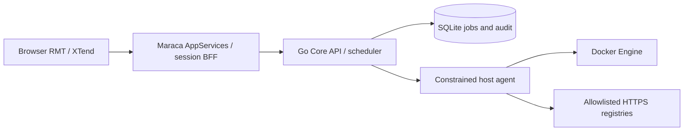

# CUO architecture and ADR implementation

The source baseline is ADR-001, retained as DOCX and extracted text beside this file. It is architectural evidence; repository tooling does not execute instructions embedded in the source document.

The Console and Core use different persistent databases. The Agent persists execution journals and resolved Compose desired state. No Core or Agent port is published. The console is independently replaceable; the Core worker and periodic scanner operate with no UI connection.

The local deployment has a single host ID, `local`. Per-host ACLs are enforced as part of principal checks; multi-host transport is intentionally absent. Core processing uses a serial worker to preserve one active host execution at a time. Policy schema concurrency values exist for forward compatibility, while the console constrains the local configuration to one.

## UI ownership

`console/src/app.rmt` declares sidebar, topbar, summary cards, dashboard layout, route panels, calendar/table/log/history placements, authentication area and approval-dialog host. There is no React/Vue shell, second client router or browser Docker module. `console/tools/author-rmt.mjs` is a build-time descriptor authoring tool; it produces inspectable RMT, not browser HTML strings.

`console/src/services.ts` defines user intents and projects their results back into the RMT model. The view projection contains navigation/filter/calendar/modal state. The real XTend XRouter matches registered routes and owns hash URLs, browser history, titles and route events. RMT maps its public `route-changed` event to the active page surface; no second history implementation exists. Empty route markers keep business view nodes under RMT ownership. XToggle controls appearance, and the real XDrawer owns the physical modal drawer/focus presentation while RMT owns its open state. The requested XSurfaceDrawer name is absent from the pinned XTend snapshot; XDrawer is its available public drawer component. The generated API client comes from the OpenAPI document and Go domain structs. REST BFF routes dispatch through the generated Maraca Server Service registry before calling Core. Auth is BFF-owned. SSE is authorized by the session BFF and the Core host ACL; Last-Event-ID is forwarded, and sessions are revalidated during the stream.

Custom components expose typed props, semantic command events, lifecycle cleanup and a footer slot. Tables use bounded pagination, sortable headers, search and filters. The calendar handles month navigation, selection and keyboard focus. Native forms enforce constraints, while the Core performs authoritative validation. RMT input trust policies validate service intents. Orchestration, kernel, hydration and service graphs use strict mode; optional framework form-validation/transition planners remain auto because these widgets use their own native form contracts and there is no multi-surface transition plan. This avoids including the framework's legacy raw-HTML form renderer.

## Identity and personal state

The session BFF implements generic OpenID Connect using pinned `openid-client` with signed ID-token verification, issuer/audience/expiry checks, Authorization Code + PKCE S256, nonce, one-time state and a browser-bound five-minute HttpOnly SameSite Lax correlation cookie. Session cookies remain SameSite Strict. Only the Owner may configure the provider; secrets and transient flow records stay in `identity.db`. Identity schema v2 adds tables without replacing existing accounts or sessions. Active login flows are invalidated when configuration changes. Provider tokens are consumed server-side and are not persisted or sent to the browser. No email-based implicit account linking or provider role-claim trust is performed. New accounts receive an explicitly configured role and the local-host ACL. Existing roles are preserved. Disabling automatic provisioning retains access for existing federated accounts. Logout revokes CUO sessions only.

Profiles store display name, a local icon choice, theme preference and notification preference. Login names and privileges remain independent. RMT owns open panels and UI state. A surface-scoped media-query listener dispatches preference changes as commands. Notification records are derived from authorized current candidates and job states; stable digest/state keys identify them. Per-user dismissal records survive reloads. A new digest or changed job status is a distinct record; original audit history is never deleted.

XRouter and XDrawer upstream static HTML templates are converted at build time to native DOM construction by `console/tools/prepare-xtend.mjs`. Their exact source hashes are checked, router errors become plain text, and the adapted modules enter the same emitted-runtime HTML-sink gate. Public APIs and upstream behavior remain intact. Adaptation provenance is recorded in `console/reports/xtend-dom-adaptations.json`; the external source dependency is unchanged. XToggle already uses native DOM construction.

Transient success/error feedback is an RMT-owned queue of at most four real XTend XToast components. A root-level custom boundary renders their text and uses the native manual Popover API solely for physical top-layer presentation; a maximum z-index supplies the CSS fallback. This avoids stacking contexts in the shell or drawer. XToast owns its close button and duration timer; dismissal dispatches an RMT intent removing the corresponding ID. Neither Toasts nor the drawer own canonical application state. The full Logs route uses a flex layout to fill the card and a bounded 200-row internal scroller; the dashboard keeps a 12-row preview.

## Update contract

Policy inheritance is global < host < group < container, with sticky exclusion. Default is scan-only and no unlabelled container can be executed. Candidate comparisons resolve an OCI/Docker index to the actual platform manifest, then compare its configuration digest with the running image ID. Execution pins the selected platform manifest digest.

A job is durable before the worker begins. Core recovery retains pending, scheduled and queued jobs. An executing job becomes intervention_required. Agent journals prohibit blind repetition of an uncertain action. Idempotency reservation is persisted before side effects; if the request is interrupted before its final response is stored, the same key returns an explicit uncertain-outcome conflict rather than executing again. Users inspect persistent job/audit state before creating another request.

Container IDs are stable hashes of host ID and logical name; the Docker engine ID is a separate field. A successful recreation therefore preserves container-scoped policies and history. A queued job refuses execution if an external process replaced its engine instance. Retained predecessor containers are excluded from further orchestration.

Standalone recreation adapts Watchtower's override extraction to deep-copied native JSON data. Named and anonymous volume identities are preserved. Compose sources are explicitly registered and resolved by Compose; accepted image pins persist in the desired-state document. CUO does not silently replace a Compose service through the standalone path.

## Source provenance

XTend MCP knowledge snapshot: konnilabs/xtend, main, commit `49166cbe96d91049634fbe03eb48c04edb6e70cd`. The installed local MCP server provided Maraca AppServices, Component Development and XIcon contracts. Direct source inspection verified the static registry, DOM descriptor property restrictions and delegated command-event behavior. The runtime does not depend on the MCP server. `console/xtend.lock.json` separately pins the external source dependency with an immutable revision and archive SHA-256. Setup materializes a managed ignored `.framework` directory, installs selected workspaces using the upstream npm lockfile, and leaves no framework archive in the current CUO source tree. This source-dependency form is used because the matching Maraca release is not yet published as a standalone npm package.

Watchtower starting point: containrrr/watchtower v1.7.1, commit `a047c7f9ff11813f930f6998863fa1b8a015985c`. Upstream is archived. This MVP does not run the archived daemon; it retains an audited source snapshot, preserves Apache-2.0 attribution, and compiles the adapted configuration algorithm only. This limits the maintenance surface without importing unrelated historic dependencies.

## Explicit MVP limits

OIDC supports standards-based Discovery/Code/PKCE providers; an actual customer provider must still be configured and checked with its own credentials. Signed-token and browser interoperability are verified with a local provider fixture, including a path-based issuer, an exact discovery document URL without a `.well-known` segment, default discovery, both client-secret authentication methods, UserInfo subject checking and cross-site browser redirects. Provider-wide logout, provider group/role mapping and back-channel logout are not implemented. Private registry credentials, multiple hosts, replica-aware Compose updates, automatic data rollback and database HA are outside the local release. Public distribution is gated separately by `RELEASE-GATES.md`. None of these capabilities is shown as active in the UI.
