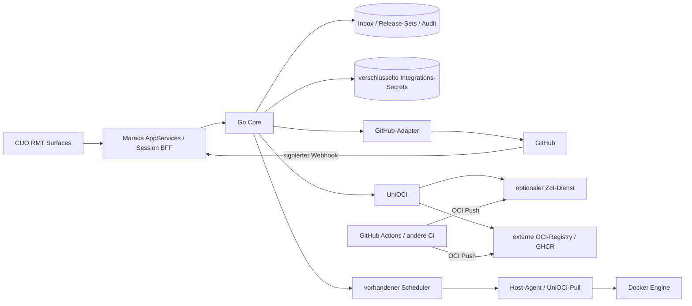

# CUO 0.2.0 – UniOCI, Zot und native GitHub-Anbindung

Stand: **2. November 2026**. Status: **Implementierungsplan**, keine bereits ausgelieferte Funktionsbeschreibung. Ausgangspunkt ist CUO 0.1.0 einschließlich der lokalen Ausführungsfreigabe aus Commit `b2c5f65`. Versionen, Images und öffentliche Feature-Angaben werden erst bei der jeweiligen Implementierung beziehungsweise Release-Abnahme umgestellt.

## 1. Ziel und verbindlicher Umfang

CUO 0.2.0 verbindet vorhandene Docker-Workloads mit universellen OCI-Registries und einer optional mitinstallierten Zot-Registry. GitHub erhält einen nativen Einrichtungsablauf, Repository-/Workflow-Auswahl und eine dauerhafte Webhook-Verarbeitung. Die gesamte Bedienung bleibt in der CUO-Shell und wird in Maraca/RMT umgesetzt.

| Bestandteil | Lieferumfang für 0.2.0 |
| --- | --- |
| **UniOCI** | Herstellerneutraler CUO-Vertrag für Registry-Verbindungen, Image-Referenzen, Tags, Manifeste, Plattform-Digests, private Credentials und Artefakt-Metadaten. Getrennte optionale Provider-Fähigkeiten. |
| **Integrierte Registry** | Optionaler, separat persistierter Zot-Dienst; Installation, sichere Erstkonfiguration, Status und Einrichtung in CUO, Push aus CI und Pull durch Docker. Bestehende externe Registries bleiben gleichwertig verwendbar. |
| **GitHub** | Selbst gehostete GitHub-App pro Installation beziehungsweise Anbindung, ausgewählte Repositories, kurzlebige Installationstokens, Publish-Workflow-Zuordnung, Webhooks, Inbox und Wiederabgleich. |
| **Veröffentlichung → Update** | Digestgebundene Release-Sets aus einem erfolgreichen Publish-Workflow, wahlweise direkter Bezug aus GHCR/Zot oder ausdrücklicher Import nach Zot. Übergabe an die vorhandenen Update-Jobs mit deren Prüfungen. |
| **Berechtigungen** | Eigene RMT-Surface mit Checkbox-Matrix für tatsächlich implementierte Aktionen. Ausführen und zusätzliche Ausführungsfreigaben erteilen sind getrennte Rechte. Sichere Standardwerte übernehmen die bestehenden Rollen. |
| **Betrieb und Release** | Migration, Geheimnisverwaltung, Backup/Restore einschließlich optionaler Registry, Betriebsdiagnose und überprüfbare Release-Artefakte. Bekannte Scheduler-/Eligibility-Fehler werden vor ereignisgesteuerten Updates behoben. |

Namespaces, Repository-Namen, Release-Kanäle und Container-Zuordnungen sind Konfiguration. Weder XTend noch eine GitHub-Organisation erhalten Sonderlogik. Eine Beispielkonfiguration für XTend darf diese allgemeinen Verträge nutzen. Die Registry funktioniert auch ohne GitHub; GitHub kann auch ohne lokalen Zot-Dienst verwendet werden.

Weiterhin außerhalb dieser Minor-Version: Multi-Host-Transport, Datenbank-HA, automatische Wiederherstellung von Workload-Daten, Kubernetes, allgemeiner Remote-Shell-/Docker-API-Zugriff und beliebige neue privilegierte Host-Aktionen. GitHub.com ist die erste abgenommene GitHub-Plattform; GitHub Enterprise Server benötigt eine eigene Kompatibilitätsprüfung. Das bisherige CUO-Login einschließlich OIDC bleibt unabhängig von der GitHub-Anbindung.

## 2. Architektur und Zuständigkeiten



- **RMT** besitzt Seiten, Navigation, Filter, Auswahl, Dialogzustand und projektierten Anwendungszustand. Komponenten besitzen nur ihre interne Darstellung und kurzlebige Interaktion.
- **BFF** bleibt Browser-Sicherheitsgrenze: Session, CSRF, Origin, erlaubte AppServices und berechtigungsgeprüfte DTOs. Ein eng begrenzter Webhook-Eingang nimmt den unveränderten Request-Body an und reicht ihn intern weiter; der Core prüft die GitHub-Signatur vor Annahme.
- **Core** besitzt Verbindungen, Secret-Verweise, GitHub-App-Verwaltung, dauerhafte Inbox, Wiederabgleich, Release-Sets und Subscription-Entscheidungen. Keine Container-Aktion läuft im Browser oder im Webhook-Request.
- **UniOCI** ist eine interne Go-Schnittstelle mit versionsfähigem API-/DTO-Vertrag, kein neu erfundenes Registry-Protokoll. Der gemeinsame Client wird für Core-Metadaten/Import und Agent-Scan verwendet.
- **Agent** bleibt der einzige Pfad zur Docker-Ausführung. Registry-Zugangsdaten erhält er nur für den jeweiligen Scan beziehungsweise Pull und speichert sie nicht im Journal oder Compose-Sollzustand.
- **Zot** besitzt OCI-Blobs und Registry-Metadaten in einem eigenen Volume. Es bekommt keinen Docker-Socket. CUO besitzt Zuordnungen und Rollout-Entscheidungen, keine zweite Blob-Datenbank.

Der Core benötigt künftig ausgehenden Netzwerkzugriff für GitHub und Registry-Importe; die heutige ausschließlich interne Netzzuordnung reicht dafür nicht aus. Eine eigene Compose-Netzzuordnung wird ergänzt. Core und Agent erhalten weiterhin keine veröffentlichten Ports. Registry-Endpunkte, Auth-Realm-Hosts, Redirects und Download-Ziele werden ausdrücklich zugelassen und geprüft. Ein konfigurierbarer Registry-Endpunkt ist kein allgemeiner URL-Proxy.

## 3. XTend-/RMT-Vorgaben und geprüfte Grundlage

Der lokale Docker-Dienst `xtend-mcp-mcp-1` wurde am 2. November 2026 über seine authentifizierte MCP-API abgefragt. Er bietet in dieser Installation `xtend_knowledge_search` und `xtend_knowledge_context`; er bietet **keine** Compile-/Repair-Tools. Abgerufen wurden Verträge zu Surfaces/Lifecycle, AppServices, Component Development, XRouter, Accessibility und Runtime-Retention. Herkunft und Quellen-Hashes stehen im [Planungsnachweis](../reports/unioci-planning.json).

MCP meldet XTend-Commit `0e2e7c9e7ee3cf7316ff8b9073ec033e7c7d0836`. CUOs vorheriger Pin war `49166cbe96d91049634fbe03eb48c04edb6e70cd`. Der neuere Stand enthält insbesondere PR #118 mit begrenzten Maraca-Historien und State-Projection-Journalen. Dieser für länger laufende CUO-Sitzungen relevante Dependency-Wechsel wird separat von den 0.2.0-Features geprüft. Archiv-Hash und Revision bleiben in `console/xtend.lock.json` unveränderlich gepinnt. XRouter/XDrawer sind zwischen diesen Ständen bytegleich; die vorhandenen überprüften DOM-Anpassungen bleiben erhalten. Kein automatischer Wechsel auf ein bewegliches `main` oder `latest`.

Für jede neue Surface gelten folgende Abnahmeregeln:

1. RMT-Quelle und inspectierbarer Buildplan über `console/tools/author-rmt.mjs` / `console/src/app.rmt`; genau eine Maraca-Laufzeit und der vorhandene XRouter. Neue Unterrouten werden ausdrücklich registriert; die derzeitige Seitennamen-Auswertung in `services.ts`/`view.ts` wird passend erweitert und getestet.
2. Typisierte DTOs aus OpenAPI sowie Browser-/Server-AppServices. Mutation über semantische Intents und den RMT-Eventpfad; keine zweite Zustandsverwaltung in Widgets, kein Browserzugriff auf GitHub-/Registry-Secrets.
3. Wiederverwendung der belegten XIcon-, XToggle-, XDrawer- und XToast-Verträge. Weitere Standardkomponenten erst nach Prüfung im gepinnten Manifest und über MCP übernehmen; keine angenommenen Komponentennamen oder privaten Shadow-DOM-Zugriffe.
4. Fehlende UI-Bausteine werden im CUO-Komponentenpaket als Custom-XTend-Komponenten registriert: ESM-Datei, Typen/Prop-Vertrag, `xtendComponentContract`, `xtendRmtMetadata`, öffentlicher Event-/Slot-Vertrag und Eintrag in der statischen RMT-Build-Registry. Die bisherige `register()`-Grenze in `components/base.mjs` wird weiterverwendet. Kein Patch in der externen XTend-Dependency.
5. Komponenten senden `xtend-command`-Intents; ihre Daten kommen aus dem RMT-Modell. Netzwerkantworten nach Surface-Wechsel dürfen keine veraltete Darstellung übernehmen. Listener und laufende Darstellungsarbeit werden beim Schließen entsorgt.
6. Design-Tokens für hell/dunkel, XIcon für Symbole, zugängliche Namen, Tastaturbedienung, Fokus-Rückkehr und textliche Fehlerzustände. Keine HTML-Strings aus Registry-/GitHub-Inhalten, keine eingebettete Zot-/GitHub-Weboberfläche.
7. Strikter bestehender Maraca-Build, TypeScript, Source-/HTML-Sink-Gate und Browser-Smokes. Die vorhandenen `validation: auto` / `transitions: auto` werden nicht ohne implementierte Verträge bloß zu `strict` umgeschaltet.

## 4. UniOCI-Vertrag und Datenmodell

Neue Module sind unter `internal/unioci/`, `internal/integrations/`, `internal/github/` und `internal/core/` vorgesehen. ORAS Go v2 ist der vorgesehene Client-Kandidat für OCI-Transport/Copy; vor Übernahme sind Go-Kompatibilität, Auth-Verhalten, Lizenz, CVEs und die Integration mit CUOs Endpunktregeln nachzuweisen. Die Bibliothek bleibt hinter UniOCI gekapselt. [ORAS Go](https://github.com/oras-project/oras-go)

| Entität | Wesentliche Daten / Invariante |
| --- | --- |
| `RegistryConnection` | Stabile ID, Provider `oci`/`zot`/`ghcr`, kanonischer Host, getrennte erlaubte interne Endpunkte, TLS-/CA-Verweis, Repository-Grenzen, Credential-Verweise, Revision und Zustand. |
| `RegistryCapabilities` | Einzelne Fähigkeiten wie Tag-Liste, Referrers, Repository-Katalog, Copy, API-Schlüssel oder Retention-Vorschau. Fehlende Fähigkeiten sind sichtbar und werden nicht simuliert. |
| `CredentialRef` | Zweck, Registry/Repository/Host-Grenze, Secret-Version, Ablauf-/Widerrufsstatus; niemals Secret-Wert im Lese-DTO. |
| `ArtifactDescriptor` | Repository, Medienart, Index-/Manifest-Digest, Plattform-Digests, Größe, Tags, Annotationen und Referrers. „Vorhanden“, „geprüft“ und „verifiziert“ bleiben unterschiedliche Zustände. |
| `GitHubConnection` | App-ID, Installation(en), Account-/Repository-IDs, gewährte Rechte, Secret-Verweise, Sync-Wasserzeichen und Zustand. Namen sind Anzeige, IDs sind Autorisierungsgrundlage. |
| `WebhookDelivery` | Verbindung + Delivery-ID als eindeutiger Schlüssel, Payload-Hash, begrenzte notwendige Nutzdaten, Zustand, Versuche, Fehlerklasse und Zeitpunkte. |
| `ReleaseSet` | Unveränderliche Menge aus logischen Komponenten und Image-Digests, Quelle/Revision/Workflow-Lauf, Kanal, Prüfergebnissen und Vollständigkeitsstatus. |
| `Subscription` | Verbindung, Repository-/Workflow-ID, erlaubter Ref/Kanal, erwartete Image-Repositories, optionale Zot-Import-Zuordnung, Container-Ziele und Automationsmodus. |
| `PermissionPolicy` | Versionsfähige Matrix aus Rollen und implementierten Fähigkeiten; atomare Änderung mit Vorher/Nachher-Audit. |

UniOCI bietet mindestens `Probe`, `ListTags`, `Resolve`, `FetchManifest`, `ListReferrers` und `CopyByDigest`. Provider-Erweiterungen sind getrennte Interfaces. Eine Repository-Gesamtliste wird nicht als überall verfügbare OCI-Eigenschaft vorausgesetzt: Bei fehlendem Katalog dienen konfigurierte Repositories, entdeckte Workload-Referenzen und autorisierte GitHub-Zuordnungen als Quellen. Tags werden paginiert; Referrers unterstützen den vorgesehenen Fallback. [OCI Distribution 1.1.1](https://github.com/opencontainers/distribution-spec/blob/v1.1.1/spec.md)

Der heutige `splitRef` wird ersetzt beziehungsweise hinter einem geprüften Referenzparser migriert: Registry mit Port, implizites Docker-Hub-`library/`, `tag`, `@digest` und `tag@digest` benötigen eigene Fälle. Lokal gebaute Images werden als lokal/unveröffentlicht gekennzeichnet, statt irreführende Registry-Auth-Fehler zu erzeugen. `CUO_REGISTRIES` wird rückwärtskompatibel in sichere initiale Verbindungen übernommen; vorhandene unzulässige Hosts werden nicht durch die Migration freigeschaltet.

Schemaänderungen sind additiv und versioniert. Alte Richtlinien, stabile Container-IDs, Jobs und OIDC-Daten bleiben erhalten. Vor einem Schemawechsel wird gesichert; ein Downgrade erfolgt über die geprüfte Sicherung, nicht durch Start eines alten Binaries gegen eine neue Datenbank.

## 5. Geheimnisse und private Registry-Zugriffe

Vorgesehen ist ein Core-eigener Secret Store im Core-Volume mit authentifizierter Verschlüsselung und versionsfähigem Schlüsselformat. Der Installationsschlüssel liegt separat als geschützte, nur lesend eingebundene Datei unter `/run/secrets`; er wird weder ins Image noch in die Datenbank eingebaut. Dateirechte allein ersetzen die Verschlüsselung nicht. Besitzer des Hosts beziehungsweise Docker-Sockets liegen weiterhin außerhalb dieser Anwendungsschutzgrenze.

- Getrennte Zwecke für Registry-Pull, CI-Push, Zot-Verwaltung, GitHub-App-Schlüssel und Webhook-HMAC. Keine Wiederverwendung eines allgemeinen Admin-Tokens für alle Aufgaben.
- Secrets werden nur schreibend entgegengenommen. Normale GETs liefern Status, Fingerprint/Version und Ablauf; kein „Secret anzeigen“ oder Export im Browser. Ein neu erzeugter CI-Schlüssel darf einmal ausdrücklich ausgegeben werden, mit festgelegtem Scope.
- Der Agent erhält kurzlebig gültige, zweckgebundene Credential-Envelopes über den internen authentifizierten Kanal. Sie gehören nicht zum persistierten `Operation`-Modell: `a.journal(op, …)` schreibt heute Operationsdaten und darf dadurch keine Credentials aufnehmen.
- Beide Pfade werden implementiert und getestet: authentifizierte Manifestabfrage **und** Docker-Engine-Pull mit `X-Registry-Auth`. Compose darf erst nach erfolgreichem Digest-Pull ohne zusätzlichen unkontrollierten Pull abgleichen.
- Rotation und Widerruf invalidieren Caches. Wartende Jobs prüfen Verbindung und Rechte erneut. Bereits zugelassene Operationen erhalten eine ausdrücklich dokumentierte Fortsetzungsregel. Logs/Audit/Journale und Fehlerantworten werden auf Secret-Leaks geprüft.
- Registry-Realm und Redirect dürfen Credentials nicht an andere Hosts weiterreichen. Private/LAN-Registries benötigen eine ausdrückliche Endpoint-Freigabe. Metadaten-/Loopback-/fremde interne Dienste sind keine automatisch zulässigen Ziele. TLS-Prüfung bleibt aktiv; eigene CA statt `insecure-skip-verify`.

## 6. Zot-Dienst und Installationsvarianten

Zot wird als optionales Compose-Profil `registry` ergänzt. Ein dediziertes Daten-Volume und ein getrenntes Konfigurations-/Secret-Verzeichnis gehören zur Installation. Erst nach expliziter Konfiguration wird der Dienst gestartet. Die konkreten Image-Digests werden im Implementierungspaket nach Feature-/Sicherheitsprüfung gepinnt; die geprüfte Dokumentationsgrundlage ist Zot 2.1.21, keine Zusage eines ungeprüften `latest`-Images. [Zot-Konfiguration](https://zotregistry.dev/v2.1.21/admin-guide/admin-configuration/)

| Variante | Verhalten |
| --- | --- |
| Externe Registry | CUO verbindet eine vorhandene OCI-Registry; kein Zot-Container erforderlich. |
| Lokaler Zot ohne öffentlichen Ingress | Lokale Speicherung und Import über CUO; ausgehender GitHub-Abgleich möglich. GitHub kann keinen Webhook an einen ausschließlich lokalen Rechner liefern. |
| Zot mit HTTPS-Ingress | Eigener Registry-Hostname für Docker/CI, getrennt vom CUO-Web-Origin; CUO zeigt Endpunkte und passende Push-/Pull-Hinweise. Proxyvorlage für OCI-Uploads, Auth-Challenges und Größen-/Timeout-Grenzen. |

Die Registry startet mit Authentifizierung und getrennten Pull-/Push-Identitäten. Anonymer Schreibzugriff ist kein Default. Die interne API-Adresse ist nicht automatisch die Adresse, die Docker Engine oder GitHub Actions erreichen können; DNS, Zertifikatsvertrauen und Erreichbarkeit werden aus beiden Perspektiven getestet. Die CLI-Erstinstallation übernimmt Provisionierung und spätere Wartung des Zot-Containers; die Shell verwaltet Verbindung, Status und freigegebene Registry-Einstellungen. Zot wird als CUO-Systemdienst vom normalen Workload-Updater ausgeschlossen.

Zot-API-Schlüssel werden nur über die tatsächlich unterstützten Provider-Endpunkte angeboten; Scope/Ablauf und die zur Erzeugung notwendige Bootstrap-Identität werden geprüft. Ein Schlüssel besitzt nicht allein wegen seines Namens eingeschränkte Rechte. [Zot-API und API-Schlüssel](https://zotregistry.dev/v2.1.21/developer-guide/api-user-guide/)

0.2.0 zeigt Speicherverbrauch, Fehler, Erreichbarkeit und eine Retention-Vorschau. Automatische Löschung ist standardmäßig aus. Aktive, geplante und für Wiederanlauf benötigte Digests sowie deren Referenzartefakte dürfen eine CUO-gesteuerte Bereinigung nicht verlieren. Externe Verbraucher einer Registry sind CUO möglicherweise unbekannt; daraus wird keine globale Löschsicherheitsgarantie abgeleitet. HA und allgemeine Registry-Replikation bleiben spätere Ausbaustufen.

## 7. GitHub als native Integration

### 7.1 Verbindung aufbauen

Primärer Weg ist eine **GitHub-App**, die der jeweilige Anwender beziehungsweise seine Organisation besitzt. Eine zentrale konnilabs-App oder ein CUO-Cloudkonto ist nicht erforderlich. Der Wizard bietet „App anlegen“ über den Manifest-Flow und „Vorhandene App verbinden“. Der Manifest-Flow liefert serverseitig App-ID, privaten Schlüssel und Webhook-Secret. [GitHub-App-Manifest](https://docs.github.com/en/apps/sharing-github-apps/registering-a-github-app-from-a-manifest)

Geplanter Ablauf:

1. Berechtigter Owner startet den Wizard; CUO zeigt öffentlichen Callback und Webhook-URL sowie die angeforderten GitHub-Rechte.
2. Der Core speichert einen kurzlebigen, einmal nutzbaren, an Verbindung und Einrichter gebundenen Setup-Vorgang. Der Browser wird zur Registrierung auf GitHub weitergeleitet.
3. Der BFF nimmt den Callback an; der Core prüft State/Einmaligkeit und tauscht den Code serverseitig aus. Private Schlüssel oder Client-Secrets erreichen keine RMT-Projektion. Die bestehenden strikten Session-Cookies werden nicht pauschal gelockert; für den Cross-Site-Rückweg wird ein eigener begrenzter Korrelationsmechanismus nach dem bestehenden OIDC-Muster verwendet.
4. Der Anwender installiert die App für ausgewählte Repositories. CUO prüft App-/Installationszugehörigkeit über die GitHub-API; Query-Parameter allein aktivieren keine Verbindung.
5. Auswahl von Repository, Publish-Workflow und Release-Kanal; Verbindungstest, Berechtigungsübersicht und explizites Aktivieren. Neue Subscriptions beginnen im Vorschau-/Freigabemodus.

Standardrechte sind Repository-Metadaten lesen und **Actions lesen**. `workflow_run` ist damit für GitHub-Apps verfügbar. Weitere Rechte werden nur für einen tatsächlich implementierten Zusatzpfad angefordert. Kein pauschales `repo`, kein Schreiben von Quellcode oder Workflows durch CUO. [Webhook-Vertrag](https://docs.github.com/en/webhooks/webhook-events-and-payloads#workflow_run)

Der Core erzeugt Installationstokens bedarfsgerecht aus dem App-Schlüssel, beschränkt sie auf erlaubte Repositories und berücksichtigt `expires_at`. Tokenlänge oder Präfix werden nicht als stabiles Format angenommen. Die regulären Installationstokens laufen nach einer Stunde ab. Entfernung eines Repositories, Suspendierung und Deinstallation sperren die zugehörigen Subscriptions und invalidieren Tokens. [Installationstokens](https://docs.github.com/en/apps/creating-github-apps/authenticating-with-a-github-app/generating-an-installation-access-token-for-a-github-app)

**GitHub-API-Anmeldung und GHCR-Pull bleiben getrennt:** Für private GHCR-Images wird beim gegenwärtigen GitHub-Vertrag ein PAT classic mit `read:packages` benötigt; ein GitHub-App-Installationstoken wird dafür nicht als Ersatz versprochen. GitHub Actions kann für die Veröffentlichung in GHCR sein `GITHUB_TOKEN` verwenden. Der Wizard zeigt beide Verbindungszustände getrennt. [GHCR-Authentifizierung](https://docs.github.com/en/packages/working-with-a-github-packages-registry/working-with-the-container-registry)

### 7.2 Webhook-Eingang und Wiederabgleich

Geplanter Eingang: `POST /hooks/github/{connectionId}` am Console-HTTPS-Origin. Diese einzelne Route verwendet HMAC statt Benutzer-Session/CSRF und öffnet keine übrigen API-Routen. `connectionId` ist kein Geheimnis.

- Maximal zunächst 2 MiB Request-Body, begrenzte Header, Rate-/Queue-Limits. Vor JSON-Auswertung wird `X-Hub-Signature-256` über die unveränderten Bytes geprüft und zeitkonstant verglichen. Fehlende/falsche Signatur wird verworfen; es gibt keinen unsignierten Testmodus. [GitHub-Signaturprüfung](https://docs.github.com/en/webhooks/using-webhooks/validating-webhook-deliveries)
- Nur abonnierte Ereignisse und Aktionen: `ping`, Installations-/Repository-Änderungen und `workflow_run.completed`. Für Kandidaten werden ausschließlich erfolgreiche Läufe des konfigurierten Publish-Workflows angenommen. Fork-/PR-Läufe und nicht zugelassene Refs erzeugen keinen Rollout.
- Empfang und Unique-Delivery-ID werden gemeinsam dauerhaft gespeichert, bevor CUO `202` bestätigt. Zielzeit unter zwei Sekunden, ohne GitHub-/Registry-Abfrage im Request. Bei nicht verfügbarer Persistenz wird kein Erfolg bestätigt. GitHub erwartet die Antwort innerhalb von zehn Sekunden. [Webhook-Betrieb](https://docs.github.com/en/webhooks/using-webhooks/best-practices-for-using-webhooks)
- Ein Worker verarbeitet die Inbox mit begrenzten Wiederholungen und Backoff; nach Erschöpfung entsteht ein sichtbarer Fehler mit manueller Wiederaufnahme. Derselbe Delivery-Key mit anderem Payload-Hash wird als Konflikt markiert. Weitere Ereignisse zum gleichen Digest werden semantisch zusammengeführt.
- HTTP-Zustellung und Verarbeitung sind mindestens-einmal; die Seiteneffekte sind idempotent. Neustart, Retry oder manuelle Wiederaufnahme dürfen keinen zweiten Update-Job erzeugen. Inbox- und Job-Outbox-Transaktionen beziehungsweise eindeutige Schlüssel schließen den Absturz zwischen beiden aus.
- GitHub liefert fehlgeschlagene Webhooks nicht automatisch erneut. Ein alle 15 Minuten geplanter, paginierter API-Wiederabgleich mit Wasserzeichen und Überlappung schließt Lücken. Er läuft ebenfalls ohne Browser. `429`, `Retry-After`, Rate Limits und Unterbrechungen erhalten begrenztes Backoff. [Fehlgeschlagene Zustellungen](https://docs.github.com/en/webhooks/using-webhooks/handling-failed-webhook-deliveries)
- Nur lokal erreichbare Instanzen zeigen „Polling aktiv, Webhook nicht öffentlich erreichbar“. Für lokale Integrationstests wird ein eigener signierter Fixture-Sender verwendet; ein Tunnel ist eine optionale Installationsentscheidung.
- Bei Erstanbindung gibt es eine Vorschau vorhandener Releases. CUO spielt keine gesamte frühere Workflow-Historie automatisch auf produktive Container aus.

Ein zusätzliches Package-Publish-Ereignis kann später als Wakeup dienen. Es wird für 0.2.0 nicht als verpflichtender GitHub-App-Vertrag vorausgesetzt; `workflow_run` ist der überprüfte gemeinsame Weg.

### 7.3 Vom Workflow zum unveränderlichen Release-Set

CUO liefert eine generische GitHub-Actions-Vorlage, die Images baut, testet und scannt, dieselben OCI-Inhalte veröffentlicht und **erst danach** das kleine Workflow-Artefakt `unioci-release.json` hochlädt. CUO baut keine fremden Repository-Inhalte auf seinem Host. Aktionen werden im Beispiel auf überprüfte Commit-SHAs gepinnt. Vorhandene Workflows können denselben Artefaktvertrag ausgeben.

Vorgeschlagenes Schema `unioci.release.v1`:

```json
{
  "schema": "unioci.release.v1",
  "source": {
    "repositoryId": "123456",
    "revision": "0123456789abcdef0123456789abcdef01234567",
    "workflowRunId": "1234567890",
    "runAttempt": 1
  },
  "version": "1.4.0",
  "channel": "stable",
  "images": [
    {
      "component": "api",
      "reference": "ghcr.io/example/api",
      "digest": "sha256:aaaaaaaaaaaaaaaaaaaaaaaaaaaaaaaaaaaaaaaaaaaaaaaaaaaaaaaaaaaaaaaa"
    }
  ]
}
```

Das Schema ist ein geplanter CUO-Vertrag, keine bestehende GitHub-/OCI-Norm. IDs werden als Strings transportiert. Der Core lädt das Artefakt ausschließlich über den verifizierten Workflow-Lauf und dessen GitHub-API-Zuordnung. Archiv-/JSON-Größe, Pfade, Anzahl und Schema werden begrenzt; Redirects auf Download-Hosts erhalten keine GitHub-Authorization-Header. Zugriff über App-Installationstokens mit Actions-Leserecht ist dokumentiert. [Actions-Artefakte](https://docs.github.com/en/rest/actions/artifacts)

Repository-/Workflow-ID, Run/Attempt, Commit, Kanal und Image-Repositories müssen zur Subscription passen. Jeder Digest wird anschließend unabhängig in der konfigurierten Registry aufgelöst und für die Host-Plattform geprüft. Der Webhook enthält keinen frei ausführbaren Image- oder Docker-Befehl. Eine verschobene Tag-Referenz darf den im Release-Set festgehaltenen Digest nicht austauschen. Vorhandene Digest-Pins bleiben unveränderlich, bis eine ausdrückliche Subscription sie als gewünschte Zielversion verwalten darf.

Für mehrere zusammengehörige Images ist das Release-Set erst vollständig, wenn alle erwarteten Komponenten und erforderlichen Nachweise vorhanden sind. Ein optionaler Import nach Zot kopiert per Digest und prüft den Zieldigest einschließlich erforderlicher Referrers vor Freigabe. Import erhält eine eigene Queue mit zunächst einem Copy-Worker und begrenztem Ressourcenverbrauch. Kein Rebuild beim Kopieren.

Vollständigkeit ist keine atomare Ausführung über mehrere Container: Rollouts laufen in konfigurierter Reihenfolge, halten bei Fehlern an und melden Teilzustände. Eine Wiederherstellung von Anwendungsdaten wird nicht versprochen. Später eintreffende alte Workflow-Ereignisse ersetzen nicht stillschweigend einen bereits neueren gewünschten Stand; ein Rückschritt erfordert eine eigene ausdrückliche Entscheidung.

Eine Subscription erzeugt Kandidaten, keine pauschale Sofortfreigabe. Standard ist Vorschau/Freigabe. Automatische Ausführung benötigt explizite Aktivierung und beachtet `cuo.managed`, Ausschlüsse, Host-/Container-Rechte, Wartungsfenster und Parallelität. Das vorhandene manuell bestätigte „Alle auswählen“ bleibt der gesonderte Sofortlauf. Signatur-/Provenance-Prüfung besitzt einen sichtbaren Status; eine angehängte Datei allein bedeutet keine Verifikation. Vorgeschriebene, fehlende Nachweise blockieren den Kandidaten.

## 8. Neue Surfaces und Komponenten

Die folgenden Hash-Routen sind Zielverträge, noch keine existierenden Seiten. OIDC behält seinen bisherigen Platz unter Integrationen.

| Route / Surface | Inhalt und Kernaktionen | Neue Custom-XTend-Grenze, soweit Standardkomponenten nicht ausreichen |
| --- | --- | --- |
| `/#/registries` | Verbindungen, Provider-Fähigkeiten, Status, Registry verbinden, Zot-Einrichtung anzeigen | `x-unioci-registry-list` |
| `/#/registries/:id` | Verbindungsdaten, Auth-Status, konfigurierte Repositories, Zot-Betriebsinformationen | `x-unioci-registry-settings` |
| `/#/registries/:id/repositories` | Repository-/Tag-Suche, Pagination und Artefaktauswahl | `x-unioci-repository-browser` |
| Artefakt-Drawer | Index/Plattform, Digests, Referrers, Prüfstatus, Workload-Zuordnung und Import-Vorschau | `x-unioci-artifact-detail` innerhalb des vorhandenen Drawer-Vertrags |
| `/#/integrations/github` | App-Wizard, Installationen, erlaubte Repositories, Verbindung prüfen/trennen | `x-cuo-github-connection` |
| `/#/integrations/github/:id/deliveries` | Inbox-Status, Ursache, Run-/Job-Verknüpfung und berechtigte Wiederaufnahme | `x-cuo-webhook-inbox` |
| `/#/subscriptions` | Repo/Workflow/Kanal → Image-Set → Container, Vorschau und Automationsfreigabe | `x-cuo-release-subscriptions` |
| `/#/users/permissions` | Fähigkeiten × Rollen, wirksame Rechte, Änderungsgrund und Bestätigung | `x-cuo-permission-matrix` |
| Container-Einstellungen | Tabs für bestehende Konfiguration, Image-Quelle/Subscription und tatsächliche Ausführungsfreigaben | bestehendes Dialogsystem erweitern; kein funktionsloser Icon-Upload-Tab |

Detailsuche und Unterrouten müssen Reload, Zurück/Vorwärts, Direktaufruf, ungültige IDs und Rechteentzug abdecken. Die Auswahl wird über stabile IDs im RMT-Modell geführt. Lange Repository-/Digest-/Policy-Namen dürfen Cards nicht überlaufen. Tabellen übernehmen die vorhandenen Sortier-, Pagination- und `aria-sort`-Muster.

Jede Surface erhält Lade-, Leer-, Fehler-, widerrufene und nicht unterstützte Zustände. Demo-Daten sind vom Live-Betrieb getrennt und lösen keine Webhooks, Imports oder Docker-Aktionen aus. Benutzertexte beschreiben die Aufgabe; interne Protokolldetails stehen nur in hilfreichen Diagnoseansichten.

## 9. Rollenmatrix und Ausführungsrechte

Die Matrix enthält ausschließlich serverseitig implementierte Fähigkeiten. Beispielhafte Anfangsrechte:

| Fähigkeit | Viewer | Operator | Administrator | Owner |
| --- | --- | --- | --- | --- |
| Autorisierte Bestände/Registry-Metadaten lesen | ja | ja | ja | ja |
| Registry-/Update-Prüfung starten | nein | ja | ja | ja |
| Update-Job anfordern | nein | ja | ja | ja |
| Updates freigeben / manueller Sammellauf | nein | nein | ja | ja |
| Subscriptions und gewöhnliche Richtlinien verwalten | nein | nein | ja | ja |
| Registry-Verbindungen und GitHub-Anbindung verwalten | nein | nein | nein | ja |
| Lesenden Host-Monitoring-Zugriff freigeben | nein | nein | nein | ja |
| Rollenmatrix ändern | nein | nein | nein | ja |

Diese Anfangswerte werden als Migration übernommen, einschließlich vorhandener OIDC-Administrator-Konten. Zusätzliche Rechte werden nicht automatisch aus der neuen Version abgeleitet. Bestehende Host-ACLs und Registry-/Repository-Grenzen gelten zusätzlich.

Der Owner kann unterstützte Aktionsrechte ausdrücklich delegieren. Rollenverwaltung und Schutz des letzten Owner bleiben feste Verwaltungsgrenzen. Secret-Werte werden auch bei delegierten Konfigurationsrechten nicht lesbar. Die heutige feste Owner-Prüfung für Monitoring-Freigaben muss bei einer vorgesehenen Delegation gemeinsam in BFF, Core und UI ersetzt werden; ein UI-Häkchen ohne diese Änderung ist nicht lieferbar. Aktuelle Aufschriften „Owner-Freigabe“ werden dann durch akteursbezogene Angaben ersetzt.

Wirksame Berechtigung = Rollenfähigkeit + Ziel-/Host-Berechtigung + benötigte containerbezogene Ausführungsfreigabe + aktuelle Operationsprüfungen. Eine Rollenfähigkeit allein erweitert keinen Host-Mount. Änderung der Matrix benötigt erwartete Revision, Änderungsgrund, atomare Speicherung/Audit und erneute Prüfung wartender Arbeiten. Gleichzeitige Bearbeitung liefert einen Versionskonflikt. Laufende Operationen behalten ihre zugelassene Ausführungsentscheidung.

Beliebige Host-Schreibrechte, privilegierte Container, Volume-Löschung und freie Shell-Befehle erhalten keine scheinbar funktionierenden Checkboxen. Neue schreibende Aktionstypen benötigen jeweils einen eigenen Agent-Vertrag, Warnhinweis und Ausführungs-/Fehlertest.

## 10. Implementierungspakete und Reihenfolge

Jedes Paket liefert einen gesondert prüfbaren Commit-/PR-Umfang. RMT-Ansicht und Backend werden pro Funktionsabschnitt zusammengeführt; die UI wird nicht erst nach allen Backend-Paketen angeschlossen. Nach Paket P00/P01 werden die Aufwände anhand der Auth-/Copy-Spikes neu geschätzt; dieser Plan enthält kein ungesichertes Lieferdatum.

| Paket | Abhängigkeit | Konkrete Änderungen | Abschlusskriterium |
| --- | --- | --- | --- |
| **P00 – 0.1-Basis stabilisieren** | keine | `core/engine.go`, Eligibility-/Slot-Logik, `agent/execute.go`, Referenzparser und Backup-Startpfad. Nicht laufende Workloads ausschließen; geplante/automatische Jobs desselben Fensters deduplizieren; Capabilities fachlich klassifizieren statt jedes `CapAdd` pauschal ablehnen. Compose-v2/v5-kompatiblen Wiederanlauf absichern. | Reproduktionen der PROD-Befunde als Regressionstests; keine ungewollten Starts, keine doppelten Jobs, keine pauschale Freigabe gefährlicher Capabilities. Bestehende Updates/Restore weiter erfolgreich. |
| **P01 – Verträge und Migration** | P00 | ADR-002 für UniOCI/Provider-Fähigkeiten, ADR-003 für Secrets/GitHub-Inbox; neue Core-Modelle/Schema-Migrationen; OpenAPI und generierter TS-Client; Compose-Egress-Konzept. | Upgrade einer 0.1-Datenkopie und Rückweg über Backup geprüft; DTOs enthalten keine Secrets; State-/Fehlerautomaten festgelegt. |
| **P02 – Secret Store / private Pulls** | P01 | `internal/integrations/secrets*`, Installer/Key-Datei, Credential-Envelope, Registry-Auth und Docker-Pull. BFF/Agent-Journale auf Leakage begrenzen. | Private Registry: Scan und echter Update-Pull erfolgreich; falsche/abgelaufene/widerrufene Credentials scheitern ohne Workload-Veränderung und ohne Secret-Ausgabe. |
| **P03 – UniOCI-Client / externe Registry** | P01, P02 | `internal/unioci/*`, ORAS-Spike und Pin, Referenzparser, Capability-Probe, Tag-/Manifest-/Referrer-Abfragen, Agent-Anbindung; erste Registry-Surface. | Gleicher Kernvertrag gegen Zot und einen unabhängigen OCI-Server; öffentliche GHCR-Abfrage; Plattform-, Pagination-, Digest- und Endpoint-Schutzfälle grün. |
| **P04 – Zot installieren und betreiben** | P02, P03 | `compose.registry.yaml`, `dependencies/zot/` mit Pin/Notices, Installer, Proxy-/CA-Beispiele, Registry-Status und Einrichtung. | Authentifizierter CI-Push und Docker-Pull am konfigurierten Endpoint; Neustart erhält Blobs; kein anonymer Push; CUO ohne Profil weiterhin lauffähig. |
| **P05 – GitHub-App-Verbindung** | P01, P02 | `internal/github/*`, Setup-/Callback-Routen, App-JWT/Installationstokens, Repo-/Workflow-Auswahl, RMT-Wizard. | Eigene App verbindbar, bestehende App anschließbar, minimale Rechte; State-Replay/zugeordnete fremde Installation abgewiesen; Disconnect/Revocation geprüft. |
| **P06 – Webhook-Inbox** | P01, P02, P05 | Signierter Rohdaten-Eingang in `console/server/index.mjs`, Core-Inbox/Worker, Zustände, Retry und Delivery-Surface. | Signatur-, Größen-, Doppelzustellungs-, Neustart- und Audit-Tests; dauerhafte Annahme vor `202`; keine Container-Aktion im HTTP-Handler. |
| **P07 – Release-Sets / Wiederabgleich / Zot-Import** | P03–P06 | `unioci.release.v1` JSON-Schema, sichere Artefakt-Abholung, generische Actions-Vorlage, Release-Set-Prüfung, Copy-Queue, API-Polling und Subscriptions. | Erfolgreicher Publish erzeugt genau den erwarteten Kandidaten; fehlerhafte/teilweise/alte Releases lösen keinen unzulässigen Rollout aus; Webhook-Ausfall wird durch Polling aufgeholt. |
| **P08 – Fähigkeitsprüfung / Rollenmatrix** | P01; für neue Aktionen P03–P07 | Zentrale Capability-Auswertung, Ablösung relevanter Rangvergleiche in BFF/Core, versionierte Matrix, RMT-Surface und Wiederanlaufprüfung. | Jede Matrixzeile verändert die tatsächliche API-Autorisierung; keine reine UI-Sperre; Standardmigration unverändert; letzter Owner und konkurrierende Änderungen geschützt. |
| **P09 – RMT-Integration vervollständigen** | vertikal ab P03; Abschluss nach P07/P08 | Komponenten/Typen/Registry, Unterrouten, Service-Intents, Container-Quell-Tabs, XIcon, Token-Styling und alle Zustände. | Keine zweite Shell/Router/State-Authority; Source-Gate und strikter Build grün; Navigation, Formularabbruch und veraltete Antworten im Browser geprüft. |
| **P10 – Betrieb, Restore und A11y** | P04, P07–P09 | Versioniertes Backupformat für Core-Secrets und optionalen Zot, Ersatzhost-Anleitung, Speicheralarm/Retention-Vorschau, Testberichte und A11y-Prüfung. | Restore mit separatem Schlüssel stellt Registry-Blobs, Konfiguration, Inbox und Jobs wieder her, ohne doppelte Ausführung; Tastatur-/Screenreader-/Kontrast-/Reflow-Funde behoben beziehungsweise Scope offengelegt. |
| **P11 – 0.2.0 Release Candidate** | P00–P10 | Versionen/README/Help/Notices, Release-Workflow für dieselben gebauten OCI-Artefakte, Scans/SBOM/Provenance/Signaturprüfung und dokumentierte Promotion. | Alle Release-Gates am finalen sauberen Commit/Digest erfüllt; lokaler Abnahmestack und manueller GitHub-Sandbox-Test erfolgreich; anschließend gesonderte Freigabe für PROD. |

Empfohlene überprüfbare Meilensteine:

- **M1:** P00–P04 – private externe Registry und integrierter Zot funktionieren mit echten Docker-Updates.
- **M2:** P05–P07 – GitHub-App, Webhook und Polling liefern vollständige, geprüfte Release-Sets.
- **M3:** P08–P10 – Rollenmatrix, alle RMT-Surfaces, Betriebs- und Restore-Verfahren sind abgenommen.
- **M4:** P11 – 0.2.0-Release-Kandidat mit digestgebundenen Nachweisen. Ein Beta-Tag vor M4 bleibt ausdrücklich Entwicklungsvorschau.

## 11. API- und Dateiinventar

Geplante API-Gruppen, jeweils mit expliziter Capability-Prüfung und Idempotenz für Mutationen:

- `/api/v1/registries`, `/{id}/probe`, `/{id}/repositories`, Artefakt-/Tag-Abfragen und Import-Aufträge.
- `/api/v1/integrations/github`, Setup-Vorgänge, Installationen, Repository-/Workflow-Auswahl und Verbindungsstatus.
- `/api/v1/webhook-deliveries` mit gefiltertem Status und berechtigter Wiederaufnahme; keine fremden Credentials oder vollständigen Request-Header ausgeben.
- `/api/v1/release-sets`, `/api/v1/subscriptions` und deren Vorschau-/Aktivierungsaktionen.
- `/api/v1/permission-policy` mit erwarteter Revision, Änderungsgrund und Audit.
- Die öffentlichen Callback-/Webhook-Pfade sind eng definierte BFF-Routen, keine generelle Freistellung der Core-API.

Bestehende Verträge `update-jobs` und `update-runs` werden weiterverwendet. Subscription-/Release-Set-ID ergänzen die Herkunft eines Jobs; Digest, Freigabe, Istzustandsvergleich und Agent-Journal bleiben verbindlich. Browser-DTOs werden über `tools/generate-api.mjs` erzeugt. Keine handgepflegte zweite Kopie des API-Modells.

Zusätzlich zu den Paketpfaden sind betroffen: `console/src/contracts.ts`, `view.ts`, `services.ts`, `server-services.ts`, `console/tools/author-rmt.mjs`, neue Dateien unter `console/components/`, `tools/install.sh`, `tools/data-common.sh`, `tools/backup.sh`, `tools/restore.sh`, `tools/test-restore.mjs`, `tools/check-images.mjs`, die CI und die Dokumentation. Die Image-Prüfung muss den optional ausgelieferten Zot-Pin berücksichtigen; die heutige Annahme von genau drei eigenen Service-Images genügt dafür nicht.

## 12. Abnahmeszenarien und Release-Grenzen

| ID | Verbindlicher Nachweis |
| --- | --- |
| A01 | Ein beliebiger Nicht-XTend-Namespace funktioniert über dieselbe UniOCI-API/UI gegen Zot und einen unabhängigen OCI-Testserver. Tests benötigen keinen Zugriff auf konnilabs. |
| A02 | Private Registry authentifiziert sowohl Scan als auch tatsächlichen Docker-Pull; Tokenrotation/Widerruf, Realm-/Redirect-Angriffe und Fehlerantworten sind geprüft. |
| A03 | Multi-Arch-Index, `tag@digest`, private CA, Pagination und fehlende Provider-Fähigkeiten ergeben korrekte, sichtbare Zustände. |
| A04 | App-Setup mit State/Callback, falscher Installation, Repo-Entzug und Tokenablauf; echte GitHub-Sandbox zusätzlich zu reproduzierbaren API-Fixtures. Reine Fixture-Tests gelten nicht als Nachweis einer echten App-Verbindung. |
| A05 | Falsche/fehlende HMAC, übergroße Requests, doppelte und vertauschte Events, Verarbeitungsabsturz und Wiederaufnahme erzeugen keine unautorisierten oder doppelten Jobs. |
| A06 | Nicht erfolgreicher Publish, PR/Fork, falscher Workflow/Ref, unvollständiges Set und nicht erwartetes Image blockieren die Übergabe. Ein späterer alter Event führt nicht zum unbeabsichtigten Downgrade. |
| A07 | Derselbe Digest kommt über Webhook, Polling und manuelle Prüfung: ein logischer Kandidat und höchstens ein aktiver entsprechender Job. |
| A08 | Nach Neustart zwischen Inbox-Annahme, Import und Job-Erzeugung wird korrekt fortgesetzt. Eindeutige Schlüssel/Outbox werden gezielt durch Fehler-Injektion geprüft. |
| A09 | Wartungsfenster, Ausschlüsse, Freigabepflicht, `cuo.managed`, Parallelität 1–4 und Compose-Projektserialisierung bleiben wirksam; gestoppte Workloads werden nicht nebenbei gestartet. |
| A10 | Zwei Images eines Release-Sets: kein Teilset wird als vollständig angenommen; Fehler beim zweiten Workload führt zu sichtbarem Teilzustand und hält weitere Schritte an. |
| A11 | Jede angebotene Rollen-Checkbox wird per API mit erlaubten und verbotenen Fällen geprüft; Rechteentzug vor Ausführungsbeginn, letzter Owner und Audit-Atomarität sind abgedeckt. |
| A12 | Alle neuen RMT-Routen funktionieren nach Reload sowie Zurück/Vorwärts. Komponenten registrieren sauber, verlieren beim Wechsel keine Listener und überschreiben keinen neueren Model-Zustand mit alten Antworten. |
| A13 | Hell/dunkel, Mobilansicht, lange Namen, Tastatur, Dialog-/Drawer-Fokus, Screenreader und 400-%-Zoom einschließlich der Checkbox-Matrix sind geprüft. |
| A14 | CUO-/Zot-Restore auf eigenen Wegwerf-Volumes erhält Secrets/Blob-Digests/Release-Sets und wiederholt keine bereits erledigte Docker-Aktion. Fehlender/falscher Installationsschlüssel wird klar erkannt. |
| A15 | Ein Dauerlauf mit mindestens 1.000 Status-/Navigationsaktualisierungen zeigt begrenzte Maraca-Historien, keine stetig anwachsende Listenerzahl und bedienbare neue Surfaces. |
| A16 | Release-Artefakte sind dieselben geprüften Bytes; aktuelle Image-/Binärscans, SBOM, Provenance und Signaturprüfung sind digestgebunden. Zot, neue Go-/JS-Abhängigkeiten und Lizenzen sind enthalten. |

Der GitHub-Abgleich braucht einen aktiven Webhook-Empfänger oder Polling; GitHub-Accounts/Organisationen können App-Installationen und Packages zusätzlich einschränken. Verbindungen melden diesen Zustand konkret. GitHub-spezifische Attestierungen sind nicht in jedem Tarif für private Repositories verfügbar; generische OCI-Nachweise und sichtbare Prüfstatus verhindern eine versteckte Tarifabhängigkeit. [GitHub-Attestierungen](https://docs.github.com/en/actions/how-tos/secure-your-work/use-artifact-attestations/use-artifact-attestations)

Backup umfasst die CUO-Daten, den optionalen Zot-Speicher und dessen konsistente Konfiguration; Schreibvorgänge werden dafür koordiniert angehalten. Der Installationsschlüssel erhält einen getrennten geschützten Sicherungsweg. Bestehende Drei-Volume-Backups bleiben lesbar. Workload-Volumes und automatische Daten-Rollbacks bleiben außerhalb dieses Archivs. Retention darf weder Restore noch benötigte OCI-Nachweise unbemerkt beschädigen.

Die Kriterien aus [RELEASE-GATES.md](RELEASE-GATES.md) bleiben verbindlich. Ein neuer Minor-Tag oder ein grüner Feature-Test ersetzt weder die noch offene A11y-Abnahme noch die Veröffentlichungskontrolle. Vor einem PROD-Rollout: gesicherter Iststand, lokale Abnahme, gemergter geprüfter Stand, verifizierte Artefakte und ein eigener Deployment-Schritt. Dieser Plan selbst legt keine GitHub-App an, aktiviert keine Webhooks und verändert keine produktiven Container.
